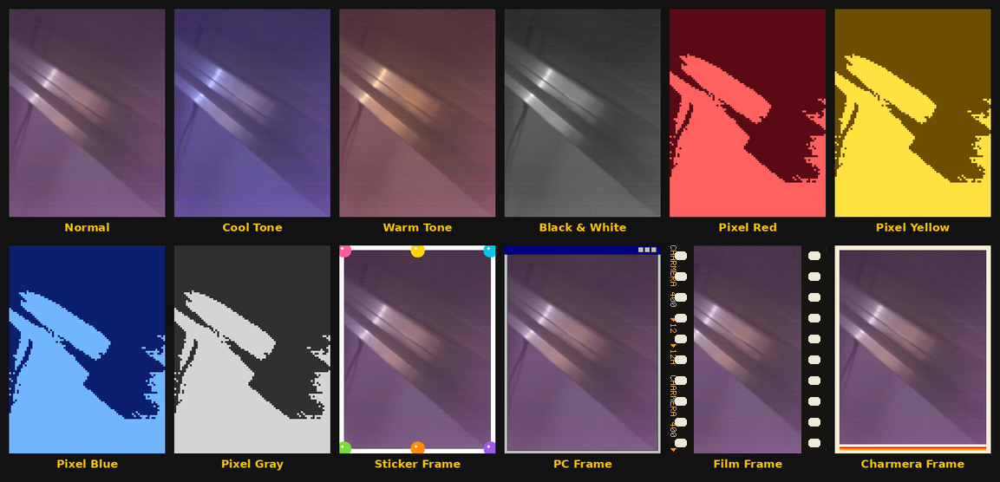
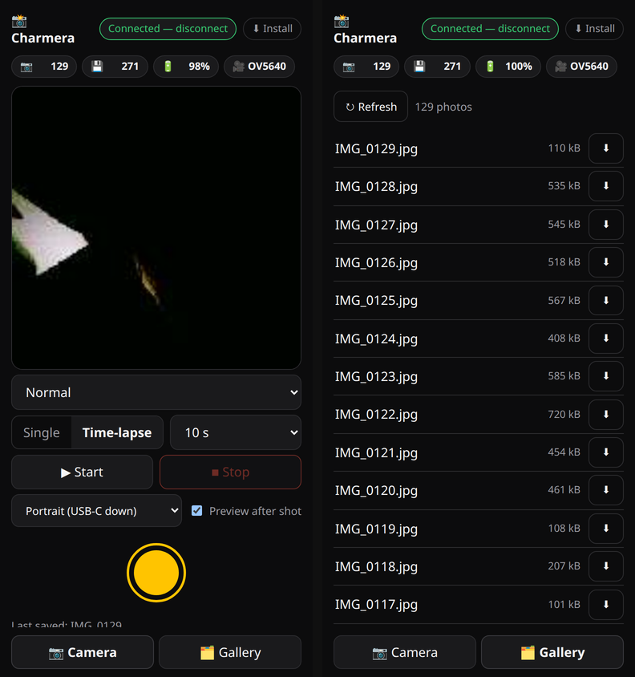
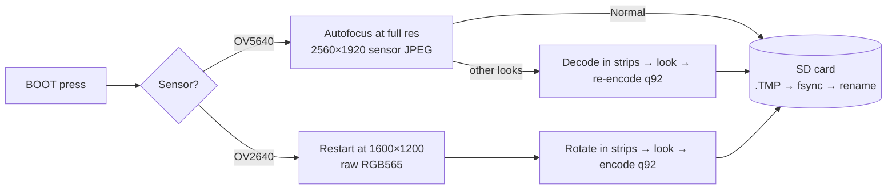

<div align="center">

# 📸 Charmera-S3

**A one-button, Kodak Charmera–style pocket camera from a $15 ESP32-S3 board.**

[](https://github.com/espressif/esp-idf)
[](https://www.espressif.com/en/products/socs/esp32-s3)
[](https://lvgl.io)
[](#)
[](#-tests)

Point it at something. Press the button. Get a photo.

No apps. No Wi-Fi. No account. It boots straight into the viewfinder.



<sub>Every look, applied by the firmware to one real photo. What you see in the viewfinder is what lands on the card.</sub>

</div>

---

## Contents

- [Why](#-why) · [Features](#-features) · [Controls](#%EF%B8%8F-one-button-does-everything)
- [Hardware](#-what-you-need) · [Quick start](#-quick-start) · [Photos](#%EF%B8%8F-photos)
- [Bluetooth remote](#-bluetooth-remote) · [How it works](#-how-it-works)
- [Status](#-project-status) · [Troubleshooting](#-troubleshooting) · [Tests](#-tests)
- [Layout](#-project-layout) · [Roadmap](#%EF%B8%8F-roadmap) · [Contributing](#-contributing)

## 💡 Why

The Kodak Charmera is a tiny keychain camera that's fun *because* it's simple: pick a look,
press the shutter, see what you got. This rebuilds that experience on an off-the-shelf
ESP32-S3 board with fully open firmware, so you can change any part of it — and fixes the
Charmera's most common complaint: **you don't have to pick a mode every time you turn it on.**

## ✨ Features

| | |
|---|---|
| 🎯 **Boots into the camera** | No mode picker on every power-up. Press, shoot. |
| 🎨 **12 looks** | Normal, Cool, Warm, Black & White, four duotone *Pixel* filters, four frames (Sticker, PC Window, Film Strip, Charmera). |
| 📷 **Best quality the sensor allows** | **OV5640-AF:** 5 MP (2560×1920) with autofocus on every shot. **OV2640:** 2 MP (1600×1200), encoded by the firmware. |
| 🔄 **Hold it any way** | Portrait, landscape either way round, or **Auto**, which turns the screen like a phone. Screen, viewfinder, frames, photos and gallery all follow. |
| 👁️ **WYSIWYG viewfinder** | Live view and encoder share the same C code per look; host tests check they agree. |
| ⏱️ **Time-lapse** | One photo every 5 s – 5 min, in its own card folder, ready to turn into video. Keeps shooting while the screen sleeps. |
| 📶 **Bluetooth web app** | An installable phone app: shoot, see each shot right after, list the card and download originals. |
| 🖼️ **Gallery** | On the camera and in the app. Newest first. Step back through shots, delete one or all on the camera. |
| 🏷️ **Full EXIF** | Camera, date/time, orientation, size, look, time-lapse run and frame. |
| 🔋 **Battery-friendly** | Dims after 30 s, off after 3 min; the sensor only runs while the viewfinder shows. |

**Safe saves:** every photo is written to a temp file, `fsync`ed, then renamed — pulling the
card or losing power never leaves a half-written `IMG_xxxx.JPG`.
**Standard card layout:** `DCIM/100CHARM/IMG_0001.JPG`, readable by any PC or photo app.

## 🎛️ One button does everything

The board drives everything from the **BOOT** button, much like the Charmera's own controls.

| | On the camera screen | In menus, gallery and settings |
|---|---|---|
| **Press** | 📷 take a photo | move down / next (older) photo |
| **Hold** (~1 s) | open the menu: *Camera · Looks · Time-lapse · Gallery · Settings* | choose |
| **Double press** | — | back / close |

Hold it **like a phone, USB-C at the bottom** by default. For landscape, change
**Orientation** in Settings. Turn on **Level** for a horizon line that turns green when
the shot is straight.

### 🔄 Orientation

In **Settings → Orientation**, hold BOOT to step through four choices:

| Setting | Hold it | Photos (OV5640 / OV2640) |
|---|---|---|
| **Portrait** (default) | upright, USB-C at the bottom | 1920 × 2560 / 1200 × 1600 |
| **USB-C right** | sideways, USB-C on the right | 2560 × 1920 / 1600 × 1200 |
| **USB-C left** | sideways, USB-C on the left | 2560 × 1920 / 1600 × 1200 |
| **Auto** | any of the three | follows the camera |

- **What turns:** screen, menus, viewfinder and level. Frames draw along the photo's own
  edges; pixel looks keep the same block size whichever way you hold it.
- **How Auto decides:** it switches only after you've clearly changed grip and held it ~0.7 s,
  so framing wobble won't flip the screen. A short message names the new grip.
- **When Auto stays put:** lying flat, mid-save, during a time-lapse run (so every frame keeps
  the same shape), with a menu open, or while the screen is off. Auto turns only the camera
  screen; gallery and settings keep the orientation they opened in.
- **Upside down:** USB-C up isn't a choice, so Auto treats it as portrait.
- **Gallery:** every photo — old or new, portrait or landscape — shows upright in both screen
  orientations, with black bars where needed.

> [!WARNING]
> Don't hold BOOT while plugging in or pressing RESET — the chip starts in download mode
> instead of running the camera.

## 🧰 What you need

| Part | Notes |
|---|---|
| [Waveshare **ESP32-S3-Touch-LCD-2**](https://docs.waveshare.com/ESP32-S3-Touch-LCD-2) | ESP32-S3R8 (8 MB PSRAM), 16 MB flash, 2" 240×320 ST7789 IPS screen, QMI8658 IMU, TF card slot, LiPo charger. |
| Camera: **OV5640-AF** (recommended) or stock **OV2640** | 24-pin DVP ribbon, detected automatically. |
| microSD card | FAT32, any size the board can mount. |
| 3.7 V LiPo with MX1.25 plug *(optional)* | Shoot untethered. |
| Linux / macOS / Windows PC | To build and flash. ESP-IDF needs ~3 GB of disk. |

**Skills:** a few terminal commands. No soldering.

> [!CAUTION]
> The OV5640 module runs **hot** and probably wants a small heat sink. The firmware does its
> part: it powers the sensor down whenever the viewfinder isn't showing, runs the viewfinder at
> a reduced clock, and releases the autofocus lens after every shot.

Pin map: [`components/board/include/board.h`](components/board/include/board.h) and
[`components/camera/camera.c`](components/camera/camera.c). Schematic: [`docs/reference/`](docs/reference/).

## 🚀 Quick start

**1. Install ESP-IDF v5.5** (one time; this repo assumes `~/esp/esp-idf`).

```sh
git clone -b release/v5.5 --recursive https://github.com/espressif/esp-idf.git ~/esp/esp-idf
~/esp/esp-idf/install.sh esp32s3
```

**2. Clone, build, flash.**

```sh
git clone https://github.com/skittleson/charmera-s3.git
cd charmera-s3
. ~/esp/esp-idf/export.sh
idf.py set-target esp32s3
idf.py build
idf.py -p /dev/ttyACM0 flash
```

**3. Shoot.** The board reboots into the viewfinder. Press BOOT to take a photo.

Build + flash + watch the log in one step:

```sh
tools/run.sh 10      # build, flash, then 10 s of serial output
```

On Linux, your user needs to be in the `dialout` group for `/dev/ttyACM0`.

## 🗂️ Photos

| Camera | Saved as | Press → "Saved" |
|---|---|---|
| OV5640-AF | 2560 × 1920 JPEG; EXIF orientation turns it to match your grip (1920 × 2560 portrait) | Normal: ~4–6 s · other looks: ~8–14 s |
| OV2640 | 1200 × 1600 portrait or 1600 × 1200 landscape JPEG, stored upright | ~6–7 s |

### 🏷️ EXIF metadata

Every photo and frame carries full EXIF, so photo apps sort and label them correctly:

| What | Tags | Example |
|---|---|---|
| Camera | Make, Model, Software, SerialNumber | `Charmera-S3`, `Charmera-S3 (OV5640)`, `charmera-s3 0.1.0`, the board's MAC |
| When | DateTimeOriginal, CreateDate, ModifyDate, OffsetTime* | `2026:11:06 19:42:05`, `-08:00` |
| Picture | Orientation, ExifImageWidth/Height, ColorSpace, resolution | portrait, `2560 × 1920` stored, sRGB |
| How it was shot | ImageDescription, UserComment | `Time-lapse 101LAPSE frame 12, every 10 s, look Normal` |
| Fixed facts | ExifVersion 0232, Flash (none), SensingMethod, ExposureMode/WhiteBalance (auto) | |

Frames name themselves: `ImageDescription` gives run and frame; `UserComment` holds
machine-readable fields —
`mode=timelapse; folder=101LAPSE; frame=12; interval_s=10; elapsed_s=110; look=Normal; camera=OV5640; orientation=portrait`.
Single photos: `mode=single; look=…; camera=…`.

The board has no battery-backed clock. **The [web remote](#-bluetooth-remote) sets the clock each
time it connects;** photos then carry the date until the camera loses power. Photos taken before
the clock is set have no date tags rather than a wrong one. Exposure time, ISO, focal length and
aperture are left out — the camera can't report them accurately.

Check a photo with `exiftool -G1 -a IMG_0001.JPG`. Numbering continues from the highest file on
the card and never overwrites. Copy photos off with a card reader.

### ⏱️ Time-lapse

1. Hold BOOT → **Time-lapse** → an interval. The badge shows `TIME-LAPSE every 10 s`.
2. Prop the camera up and **press** to start. The badge counts frames, run time and time to next.
3. **Press** again and confirm **Stop**. Cancel is selected first, so a bump won't end the run.

Each run gets its own folder (`DCIM/101LAPSE`, `102LAPSE`, …) of full-quality frames. Each frame
uses the current look; frames stay out of the gallery and photo count. The screen dims and
switches off as usual while the run continues; for intervals of 30 s and longer the sensor sleeps
between frames to stay cool. A frame takes as long as a normal photo, so with a 5 s interval the
camera just shoots as fast as it can.

Turn a run into a video with [ffmpeg](https://ffmpeg.org):

```sh
ffmpeg -framerate 24 -i /media/$USER/CARD/DCIM/101LAPSE/IMG_%04d.JPG \
       -vf "scale=1080:-2,format=yuv420p" -c:v libx264 -crf 20 timelapse.mp4
```

At 24 fps, a 10 s interval turns 1 hour into 15 seconds of video.

## 📶 Bluetooth remote



The camera advertises over Bluetooth LE as **Charmera-S3**. On by default; turn it off in
Settings to save memory and battery.

**The web app.** Open **https://skittleson.github.io/charmera-s3/** in **Chrome or Edge**
(Android, Windows, macOS, ChromeOS) and press *Connect to camera*. It's built as an interface to
the camera, not a status page:

- **Camera.** A big shutter. Pick a look from the pills, switch single / time-lapse, start and
  stop a run, change orientation. Battery, photo count and space left sit in the top bar.
- **See what you shot.** With *Preview after shot* on (the default; the switch is remembered),
  the shot appears on the page about a second after the camera says *Saved*.
- **Gallery.** Every photo on the card, newest first, as a light list of names and sizes — no
  thumbnails to wait for. Tap a name to preview it, or hit **⬇** on its row (or **⬇ Full-size**
  in the viewer) to save the original JPEG (EXIF included) to your phone or PC without pulling
  the card.

iPhone browsers don't support Web Bluetooth. On Linux, Chrome needs
`--enable-experimental-web-platform-features`.

**Install it like an app.** The page is a PWA: press *Install* (or Chrome's *Add to Home
screen*) for its own icon and full-screen window. After the first visit it opens with no
internet; Bluetooth to the camera never needs the network.

> [!NOTE]
> **Previews are fast, originals take a while.** Each new photo also gets a small 144 × 192
> thumbnail (`IMG_xxxx.THM`, about 5 KB) beside it on the card, so the after-shot preview and
> the viewer image arrive in a second or two. A full 5 MP original goes over Bluetooth at
> roughly **5–8 kB/s**, so a Normal-look photo (about 0.5–0.8 MB) takes a minute or two. For a
> whole card, a card reader is still faster. Photos taken before this firmware have no
> thumbnail; the viewer has no image for them, but the row still downloads full-size.

While a time-lapse runs, only *Stop* changes anything: looks, mode and the shutter are refused
so a stray tap can't spoil the run. Browsing and downloading still work.

**nRF Connect** (or any BLE tool). One service, `c4a30000-7b6e-4f0a-9d2e-5a1c8e3f6b20`, plus the
standard Battery Service:

| Characteristic | UUID | |
|---|---|---|
| Status JSON | `c4a30001-…` | read / notify: `photos`, `left`, `battery`, `usb`, `camera`, `look`, `lookName`, `mode`, `interval`, `intervalName`, `running`, `frames`, `elapsed`, `folder`, `card`, `busy`, `last`, `error`, `clock`, `orientation`, `orientationSetting` |
| Command | `c4a30002-…` | write text: `look <0-11>`, `mode single`, `mode lapse [0-4]`, `interval <0-4>`, `shoot`, `lapse start`, `lapse stop`, `time <unix seconds> [UTC offset minutes]`, `orientation <portrait\|landscape-right\|landscape-left\|auto>`, `list`, `thumb <n>`, `get <n>` |
| Info JSON | `c4a30003-…` | read: firmware version, look names, interval names |
| Stream | `c4a30004-…` | notify: the reply to `list`, `thumb` and `get`, framed as below |

**Stream frames.** Turn on notifications for Stream, then write `list`, `thumb <n>` or
`get <n>` to Command. Each notification is one byte of kind, then payload:

| Kind | Payload |
|---|---|
| `0` meta | JSON header, e.g. `{"kind":"get","n":109,"size":803399}` or `{"kind":"list","count":117,…}` |
| `1` data | the next slice of the file. For `list`, slices of `[[number,bytes],…]`, oldest first |
| `2` end | big-endian `u32` total byte count; check it against what you received |
| `3` error | text reason, e.g. `no photo`, `no preview`. Nothing else follows |

One transfer at a time. Slices are sized to the negotiated MTU, so a larger MTU is faster.

A rejected command reports its reason in Status (`"error":"bad look"`, `"time-lapse running"`).
Status is about 330 bytes; notifications fit when the app negotiates a large MTU (Chrome and
bleak do; in nRF Connect use *Request MTU* → 517), otherwise just read Status.

<br clear="right">

## 🔬 How it works



<details>
<summary><b>Lessons learned on the board</b> (click to expand)</summary>

- **Photos are processed in strips.** A decoded 5 MP frame doesn't fit in RAM, so the firmware
  handles a band of rows at a time. Pixel cells and frame artwork use absolute image coordinates,
  so the strips join without seams. Host tests check that strip-by-strip matches whole-image,
  including in sensor orientation.
- **The stock OV2640's JPEG output is broken on this module**, and its YUV comes out green. Its
  RGB565 is clean, so the firmware does its own JPEG encoding with `esp_new_jpeg`, and carries
  the viewfinder's exposure into the full-res shot so the photo matches what you saw.
- **The OV5640 runs autofocus at full resolution, just before the grab.** When AF ran in the
  viewfinder, later full-res frames arrived truncated.
- **Pixel filters adapt to the scene.** They split light and dark at the scene's average
  brightness, so a dim room still gives two tones instead of a solid screen.
- **Big buffers are reserved once at boot.** Allocating them per shot fragmented PSRAM until the
  camera's frame buffer no longer fit.

</details>

The full story, including every change of plan, is in
[`docs/superpowers/specs/2026-11-06-charmera-s3-design.md`](docs/superpowers/specs/2026-11-06-charmera-s3-design.md)
(see the *Revision* sections) and [`docs/build-decisions.md`](docs/build-decisions.md).

## 📍 Project status

**v1 works end to end on real hardware.** What's been verified on the board:

| Area | On the board? |
|---|---|
| Viewfinder, shutter, all 12 looks, gallery, delete, settings, level, idle dim/wake | ✅ yes |
| OV5640-AF detection, autofocus, repeated shots | ✅ yes |
| OV2640 after the dual-camera rework | ⚠️ worked before the rework, not re-checked since |
| Format card | ⚠️ built, never run on a card |
| Reading photos in a PC card reader | ⚠️ files checked over USB serial instead |
| Time-lapse at 10 s and 30 s (frames, sensor sleep, stop) | ✅ yes |
| Bluetooth remote: every command from a PC (26 checks, incl. list / thumbnail / refused download) and the web app in Chrome (17 checks, incl. preview after shot and gallery) | ✅ yes |
| Full EXIF and clock-from-remote | ✅ yes: a photo downloaded from the board over Bluetooth, checked with ExifTool |
| Full-size download over Bluetooth | ✅ yes: an 803 KB original, byte count matched, ~5–8 kB/s |
| Orientation: landscape grips, Auto, gallery in both orientations | ⚠️ host-tested and built, never on the board. Four values are derived from measurements, each a one-line flip if the board disagrees: `ORIENT_SENSOR_NATIVE`, `ORIENT_LEFT_DEG`, `rotation_for()` in `display.c`, `INPUT_DOWN_SIGN`. |

Board test results: [`docs/acceptance-2026-11-06.md`](docs/acceptance-2026-11-06.md).

## 🩺 Troubleshooting

<details>
<summary>Screen stays black, log says <code>waiting for download</code></summary>
The chip started in download mode. Make sure nothing is pressing BOOT, then tap RESET.
</details>

<details>
<summary>Flashing fails — "port doesn't exist", or the port moved to <code>/dev/ttyACM1</code></summary>
The USB serial port can get a new number after a reset. Use the stable path:
`idf.py -p /dev/serial/by-id/usb-Espressif_USB_JTAG_serial_debug_unit_* flash`.
</details>

<details>
<summary><code>Camera probe failed</code> / <code>ESP_ERR_NOT_FOUND</code> at boot</summary>
The camera ribbon has probably shifted. Unplug USB, reseat the ribbon fully, close the latch,
power on again.
</details>

<details>
<summary>Status bar says "No card"</summary>
Use a FAT32 microSD card and push it in until it clicks. The card is checked every few seconds,
so the message clears on its own once seated.
</details>

<details>
<summary>The camera module gets very hot</summary>
Expected for the OV5640, and the firmware already does what it can (see
[What you need](#-what-you-need)). A small stick-on heat sink is the real fix.
</details>

## 🧪 Tests

The pure logic builds and runs on your PC with [Unity](https://www.throwtheswitch.org/unity)
(from your ESP-IDF install). Coverage:

- the 12 looks · strip equivalence · file naming
- button and tilt state machines
- orientation mapping and Auto · EXIF writing and reading · gallery sizing · idle timing

```sh
cmake -S tests/host -B tests/host/build
cmake --build tests/host/build
ctest --test-dir tests/host/build --output-on-failure
```

### Handy tools

| Tool | What it does |
|---|---|
| `tools/run.sh [s]` | Builds, flashes, prints `s` seconds of the serial log. |
| `tools/serlog.py [s]` | Prints `s` seconds of the console. Opening the port restarts the board, so the log starts at boot. |
| `tools/dumpfiles.py log dir` | Rebuilds files sent over serial as `FILE …` / `ENDFILE` blocks — pull photos off without touching the card. |
| `tools/ble_test.py` | Runs every Bluetooth command, including the file stream, against the camera from a PC (needs `bleak`). |
| `tools/web_test.py` | Drives the web app in Chrome against the camera through Chrome DevTools: shutter, preview, time-lapse, gallery. |
| `tools/dump2png.py log dir` | Turns RGB565 `DUMP` blocks from the log into PNGs. |

## 📁 Project layout

```
components/
  board/      SPI + I2C buses, backlight, battery ADC
  display/    ST7789 panel + LVGL 9 (esp_lvgl_port)
  input/      BOOT press + tilt state machines (host-tested), QMI8658 reader
  storage/    SD mount, DCF naming, card info, atomic writes, format
  looks/      the 12 looks: pure C, strip-safe, host-tested
  camera/     sensor detection, viewfinder, full-res capture, rotation, AF
  pipeline/   capture → look → JPEG → card
  remote/     Bluetooth LE service (NimBLE), file streaming, host-tested command/status protocol
  orient/     how the camera is held: view ↔ sensor mapping, EXIF values, Auto (host-tested)
main/
  ui/         camera, gallery, settings screens; menus and toasts
  power.c     dim / screen-off / wake
  settings.c  brightness, look, level, orientation, bluetooth (NVS)
tests/host/   Unity tests that run on the PC
docs/         web app / PWA (index.html, app.js, sw.js), design, plans, acceptance, decisions, reference PDFs
```

## 🗺️ Roadmap

- [ ] 🎬 Video recording — the design leaves room for a Video mode.
- [ ] 🕒 Date stamp, with time set over Wi-Fi.
- [ ] 💾 USB drive mode — copy photos without removing the card.
- [ ] 🌡️ OV5640 heat — a heat sink, then maybe a faster viewfinder again.
- [ ] 📷 A photo of the finished camera for this README.
- [ ] Smaller items from the final review, tracked in [`docs/build-decisions.md`](docs/build-decisions.md).

## 🤝 Contributing

Issues and pull requests welcome at
[github.com/skittleson/charmera-s3](https://github.com/skittleson/charmera-s3/issues).
If something doesn't work on your board, please include:

- the boot log (`tools/serlog.py 15`)
- which camera module you have fitted
- the board version printed on the PCB

Please run the host tests before opening a pull request.

## 🙏 Acknowledgements

- [Waveshare](https://docs.waveshare.com/ESP32-S3-Touch-LCD-2) for the board, schematic and demo code the pin map came from.
- Espressif's [`esp32-camera`](https://github.com/espressif/esp32-camera), [`esp_new_jpeg`](https://components.espressif.com/components/espressif/esp_new_jpeg), and [`esp_lvgl_port`](https://github.com/espressif/esp-bsp/tree/master/components/esp_lvgl_port).
- [LVGL](https://lvgl.io) for the UI, and [Unity](https://www.throwtheswitch.org/unity) for the host tests.
- The Kodak Charmera, for showing how much fun a simple camera can be.

> This is an independent hobby project inspired by the Kodak Charmera's user experience. It isn't
> affiliated with Kodak or RETO, and the frame artwork is original.

## 🙏 Acknowledgements
