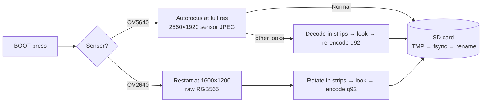

<div align="center">

# 📸 Charmera-S3

**A one-button, Kodak Charmera–style pocket camera, built from an ESP32-S3 dev board.**

[](https://github.com/espressif/esp-idf)
[](https://www.espressif.com/en/products/socs/esp32-s3)
[](https://lvgl.io)
[](#)
[](#-tests)

Point it at something, press the button, get a photo. Pick one of 12 retro looks, browse
your shots on the built-in screen, then take the microSD card home.
It boots straight into the viewfinder, with no apps, Wi-Fi or account.


<sub>Every look, applied by the firmware to one real photo from the board. What you see in the viewfinder is what lands on the card.</sub>

</div>

---

## Contents

- [Why](#-why)
- [Features](#-features)
- [Controls](#%EF%B8%8F-one-button-does-everything)
- [What you need](#-what-you-need)
- [Quick start](#-quick-start)
- [Photos](#%EF%B8%8F-photos)
- [How it works](#-how-it-works)
- [Project status](#-project-status)
- [Troubleshooting](#-troubleshooting)
- [Tests and tools](#-tests)
- [Project layout](#-project-layout)
- [Roadmap](#%EF%B8%8F-roadmap)
- [Contributing](#-contributing)
- [Acknowledgements](#-acknowledgements)

## 💡 Why

The Kodak Charmera is a tiny keychain camera that's fun because it's simple: pick a
look, press the shutter, see what you got. This project rebuilds that experience on
an off-the-shelf ESP32-S3 board with open firmware, so you can change any part of it. It
also fixes the Charmera's most common complaint: you don't have to pick a mode every time
you turn it on.

## ✨ Features

- **Boots straight into the camera.** No mode picker on every power-up.
- **12 looks:** Normal, Cool, Warm, Black & White, four duotone *Pixel* filters
  (Red / Yellow / Blue / Gray), and four frames (Sticker, PC Window, Film Strip, Charmera).
- **Best quality the fitted camera can give.** The camera is detected at boot:
  - **OV5640-AF:** 1920 × 2560 portrait photos, with autofocus on every shot.
  - **OV2640 (stock):** 1200 × 1600 portrait photos, encoded by the firmware.
- **The viewfinder matches the photo.** The live view and the photo encoder share the same C code for each look, and host tests check that both give the same result.
- **Time-lapse:** one photo every 5 s, 10 s, 30 s, 1 min or 5 min, saved in its own card folder and ready to turn into a video. It keeps shooting while the screen sleeps.
- **Gallery:** newest first. Step back through your shots and delete one or all. Delete prompts always have Cancel selected first.
- **Settings:** card size, free and used space, photo count, battery, brightness, an
  on-screen level, and card format.
- **Safe saves.** Every photo is written to a temporary file, synced, then renamed, so pulling the card or losing power never leaves a half-written `IMG_xxxx.JPG`.
- **Battery-friendly.** The screen dims after 30 s and switches off after 3 min, and the camera sensor only runs while the viewfinder is on screen.
- **Standard card layout:** `DCIM/100CHARM/IMG_0001.JPG`, which any PC or photo app can read.

## 🎛️ One button does everything

The board has no touchscreen, so everything runs on the **BOOT** button, much like the
Charmera's tiny physical controls.

| | On the camera screen | In menus, the gallery and settings |
|---|---|---|
| **Press** | 📷 take a photo | move down / next (older) photo |
| **Hold** (~1 s) | open the menu: *Camera · Looks · Time-lapse · Gallery · Settings* | choose |
| **Double press** | — | back / close |

Hold it **like a phone, with USB-C at the bottom**. Turn on **Level** in Settings for a
horizon line that turns green when the shot is straight.

> [!WARNING]
> Don't hold BOOT while plugging in or pressing RESET. If you do, the chip starts in
> download mode instead of running the camera.

## 🧰 What you need

| Part | Notes |
|---|---|
| [Waveshare **ESP32-S3-LCD-2**](https://docs.waveshare.com/ESP32-S3-LCD-2) | ESP32-S3R8 (8 MB PSRAM), 16 MB flash, 2" 240×320 ST7789 IPS screen, QMI8658 IMU, TF card slot, LiPo charger. |
| Camera: **OV5640-AF** (recommended) or the stock **OV2640** | Connects with a 24-pin DVP ribbon and is detected automatically. |
| microSD card | FAT32, in any size the board can mount. |
| 3.7 V LiPo with an MX1.25 plug (optional) | Lets you use the camera without a USB cable. |
| A Linux, macOS or Windows PC | Used to build and flash. ESP-IDF needs about 3 GB of disk space. |

**Skills:** you'll need to run a few terminal commands. No soldering is required.

> [!CAUTION]
> The OV5640 module runs **hot** and is probably meant to have a small heat sink. The
> firmware keeps it as cool as it can: it powers the sensor down whenever the viewfinder
> isn't showing, runs the viewfinder at a reduced clock, and releases the autofocus lens
> after every shot.

The pin map is in [`components/board/include/board.h`](components/board/include/board.h)
and [`components/camera/camera.c`](components/camera/camera.c). The board schematic is in
[`docs/reference/`](docs/reference/).

## 🚀 Quick start

**1. Install ESP-IDF v5.5 (one time).** This repo assumes it's in `~/esp/esp-idf`.

```sh
git clone -b release/v5.5 --recursive https://github.com/espressif/esp-idf.git ~/esp/esp-idf
~/esp/esp-idf/install.sh esp32s3
```

**2. Clone, build and flash.**

```sh
git clone https://github.com/skittleson/charmera-s3.git
cd charmera-s3
. ~/esp/esp-idf/export.sh
idf.py set-target esp32s3
idf.py build
idf.py -p /dev/ttyACM0 flash
```

**3. Shoot.** The board reboots into the viewfinder. Press BOOT to take a photo.

To build, flash and watch the log in one step:

```sh
tools/run.sh 10      # build + flash + 10 s of serial output
```

On Linux, your user needs to be in the `dialout` group to use `/dev/ttyACM0`.

## 🗂️ Photos

| Camera | Saved as | From press to "Saved" |
|---|---|---|
| OV5640-AF | 2560 × 1920 JPEG with an EXIF orientation tag, so it displays as 1920 × 2560 portrait | Normal: about 4–6 s. Other looks: about 8–14 s. |
| OV2640 | 1200 × 1600 portrait JPEG | about 6–7 s |

Photos go in `DCIM/100CHARM/`. Numbering continues from the highest-numbered file on the
card, and existing files are never overwritten. To copy photos off, put the card in a card
reader.

### ⏱️ Time-lapse

1. Hold BOOT, then choose **Time-lapse** and an interval. The badge at the top of the screen shows `TIME-LAPSE every 10 s`.
2. Prop the camera up and **press** to start. The badge counts frames, run time and the time to the next frame.
3. **Press** again and confirm **Stop**. Cancel is selected first, so a bump won't end the run.

Each run gets its own folder (`DCIM/101LAPSE`, `102LAPSE`, and so on) of full-quality
`IMG_0001.JPG`, `IMG_0002.JPG` and so on frames. Each frame uses the current look. Frames
stay out of the gallery and the photo count. The screen dims and switches off as usual
while the run continues. For intervals of 30 s and longer, the sensor sleeps between frames
to stay cool. A frame takes as long as a normal photo (about 4–14 s, depending on the camera
and look), so with a 5 s interval the camera simply shoots as fast as it can.

To turn a run into a video, put the card in a PC with [ffmpeg](https://ffmpeg.org) installed:

```sh
ffmpeg -framerate 24 -i /media/$USER/CARD/DCIM/101LAPSE/IMG_%04d.JPG \
       -vf "scale=1080:-2,format=yuv420p" -c:v libx264 -crf 20 timelapse.mp4
```

Replace `/media/$USER/CARD` with wherever your card mounts. At 24 fps, a 10 s interval
turns 1 hour into 15 seconds of video.

## 🔬 How it works



<details>
<summary><b>Lessons learned on the board</b> (click to expand)</summary>

- **Photos are processed in strips.** A decoded 5 MP frame doesn't fit in RAM, so the firmware processes a band of rows at a time. Pixel cells and frame artwork are positioned from absolute image coordinates, so the strips join without seams. Host tests check that strip-by-strip processing gives the same result as processing the whole image, including in sensor orientation.
- **The stock OV2640's JPEG output is broken on this module**, and its YUV output comes out green. Its RGB565 output is clean, so the firmware does its own JPEG encoding with `esp_new_jpeg`. It also carries the viewfinder's exposure over to the full-resolution shot, so the photo matches what you saw.
- **The OV5640 runs autofocus at full resolution, just before the grab.** When autofocus ran in the viewfinder, later full-resolution frames arrived truncated.
- **Pixel filters adapt to the scene.** They split light and dark at the scene's average brightness, so a dim room still gives two tones instead of a solid screen.
- **Big buffers are reserved once at boot.** Allocating them for each shot fragmented PSRAM until the camera's frame buffer no longer fit.

</details>

The full story, including every change of plan, is in
[`docs/superpowers/specs/2026-11-06-charmera-s3-design.md`](docs/superpowers/specs/2026-11-06-charmera-s3-design.md)
(see the *Revision* sections at the top) and in [`docs/build-decisions.md`](docs/build-decisions.md).

## 📍 Project status

**v1 works end to end on real hardware.** This table shows which parts have been checked on
the board:

| Area | Checked on the board? |
|---|---|
| Viewfinder, shutter, all 12 looks, gallery, delete, settings, level, idle dim/wake | ✅ yes |
| OV5640-AF detection, autofocus, repeated shots | ✅ yes |
| OV2640 after the dual-camera rework | ⚠️ no: worked before the rework, not re-checked since |
| Format card | ⚠️ no: built, but never run on a card |
| Reading photos in a PC card reader | ⚠️ no: files were checked over USB serial instead |
| Time-lapse | ⚠️ no: built and host-tested, not yet run on the board |

Board test results are in [`docs/acceptance-2026-11-06.md`](docs/acceptance-2026-11-06.md).

## 🩺 Troubleshooting

<details>
<summary>The screen stays black and the log says <code>waiting for download</code></summary>

The chip started in download mode. Make sure nothing is pressing BOOT, then tap RESET.
</details>

<details>
<summary>Flashing fails with "port doesn't exist", or the port moved to <code>/dev/ttyACM1</code></summary>

The USB serial port can get a new number after a reset. Use the stable path instead:
`idf.py -p /dev/serial/by-id/usb-Espressif_USB_JTAG_serial_debug_unit_* flash`.
</details>

<details>
<summary><code>Camera probe failed</code> / <code>ESP_ERR_NOT_FOUND</code> at boot</summary>

The camera ribbon has probably shifted. Unplug USB, reseat the ribbon fully, close the
latch, then power it on again.
</details>

<details>
<summary>The status bar says "No card"</summary>

Use a FAT32 microSD card and push it in until it clicks. The card is checked every few
seconds, so the message clears on its own once the card is seated.
</details>

<details>
<summary>The camera module gets very hot</summary>

That's expected for the OV5640, and the firmware already does what it can (see
[What you need](#-what-you-need)). A small stick-on heat sink on the module is the real
fix.
</details>

## 🧪 Tests

The pure logic builds and runs on your PC with [Unity](https://www.throwtheswitch.org/unity)
(taken from your ESP-IDF install). The tests cover:

- the 12 looks
- strip equivalence
- file naming
- the button and tilt state machines
- idle timing

```sh
cmake -S tests/host -B tests/host/build
cmake --build tests/host/build
ctest --test-dir tests/host/build --output-on-failure
```

### Handy tools

| Tool | What it does |
|---|---|
| `tools/run.sh [s]` | Builds, flashes, and prints `s` seconds of the serial log. |
| `tools/serlog.py [s]` | Reads the serial console without resetting the board. |
| `tools/dumpfiles.py log dir` | Rebuilds files sent over serial as `FILE …` / `ENDFILE` blocks, so you can pull photos off without touching the card. |
| `tools/dump2png.py log dir` | Turns RGB565 `DUMP` blocks from the log into PNGs. |

## 📁 Project layout

```
components/
  board/      SPI + I2C buses, backlight, battery ADC
  display/    ST7789 panel + LVGL 9 (esp_lvgl_port)
  input/      BOOT press + tilt state machines (host-tested), QMI8658 reader
  storage/    SD mount, DCF naming, card info, atomic writes, format
  looks/      the 12 looks: pure C, strip-safe, host-tested
  camera/     sensor detection, viewfinder, full-res capture, rotation, AF
  pipeline/   capture → look → JPEG → card
main/
  ui/         camera, gallery, settings screens; menus and toasts
  power.c     dim / screen-off / wake
  settings.c  brightness, look, level (NVS)
tests/host/   Unity tests that run on the PC
docs/         design, plan, acceptance results, decisions, reference PDFs
```

## 🗺️ Roadmap

- [ ] 🎬 Video recording. The design leaves room for a Video mode.
- [ ] 🕒 Date stamp, with the time set over Wi-Fi.
- [ ] 💾 USB drive mode, so photos can be copied without removing the card.
- [ ] 🌡️ OV5640 heat: a heat sink, then maybe a faster viewfinder again.
- [ ] 📷 A photo of the finished camera for this README.
- [ ] Smaller items from the final review, tracked in [`docs/build-decisions.md`](docs/build-decisions.md).

## 🤝 Contributing

Issues and pull requests are welcome at
[github.com/skittleson/charmera-s3](https://github.com/skittleson/charmera-s3/issues).
If something doesn't work on your board, please include:

- the boot log (`tools/serlog.py 15`)
- which camera module you have fitted
- the board version printed on the PCB

Please run the host tests before opening a pull request.

## 🙏 Acknowledgements

- [Waveshare](https://docs.waveshare.com/ESP32-S3-LCD-2) for the board, schematic and demo code the pin map came from.
- Espressif's [`esp32-camera`](https://github.com/espressif/esp32-camera), [`esp_new_jpeg`](https://components.espressif.com/components/espressif/esp_new_jpeg), and [`esp_lvgl_port`](https://github.com/espressif/esp-bsp/tree/master/components/esp_lvgl_port).
- [LVGL](https://lvgl.io) for the UI, and [Unity](https://www.throwtheswitch.org/unity) for the host tests.
- The Kodak Charmera, for showing how much fun a simple camera can be.

> This is an independent hobby project inspired by the Kodak Charmera's user experience.
> It isn't affiliated with Kodak or RETO, and the frame artwork is original.
