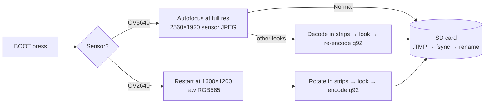

# 📸 Charmera-S3

**A one-button, Kodak Charmera–style pocket camera, built from an ESP32-S3 dev board.**

Point it at something, press the button, get a photo. Pick from 12 retro looks, browse
your shots on the built-in screen, and pull the microSD card out when you get home.
It boots straight into the viewfinder, with no apps, Wi-Fi or account.


<sub>Every look, applied by the firmware to one real photo from the board. What you see in the viewfinder is what lands on the card.</sub>

---

## ✨ Features

- **Boots straight into the camera.** No mode picker on every power-up (the Charmera's #1 annoyance).
- **12 looks:** Normal, Cool, Warm, Black & White, four duotone *Pixel* filters
  (Red / Yellow / Blue / Gray), and four frames (Sticker, PC Window, Film Strip, Charmera).
- **Best quality the fitted camera can give.** The camera is detected at boot:
  - **OV5640-AF:** 1920 × 2560 portrait photos, autofocus on every shot, saved as the sensor's own JPEG for Normal.
  - **OV2640 (stock):** 1200 × 1600 portrait photos, encoded by the firmware.
- **The viewfinder matches the photo.** Each look is one piece of pure C shared by the live view and the photo encoder, and host tests check the two give the same result.
- **Gallery:** newest first, step back through your shots, delete one or all, with Cancel always selected first.
- **Settings:** card size, free/used space, photo count, battery, brightness, on-screen
  level, and card format.
- **Safe saves.** Every photo is written to a temporary file, synced, then renamed, so pulling the card or losing power never leaves a half-written `IMG_xxxx.JPG`.
- **Battery-friendly.** The screen dims after 30 s and switches off after 3 min. The camera sensor only runs while the viewfinder is on screen.
- **Standard card layout:** `DCIM/100CHARM/IMG_0001.JPG`, which any PC or photo app reads.

## 🎛️ One button does everything

The board has no touchscreen, so everything runs on the **BOOT** button, much like the
Charmera's tiny physical controls.

| | On the camera screen | In menus, the gallery and settings |
|---|---|---|
| **Press** | 📷 take a photo | move down / next (older) photo |
| **Hold** (~1 s) | open the menu: *Camera · Looks · Gallery · Settings* | choose |
| **Double press** | — | back / close |

Hold it **like a phone, USB-C at the bottom**. Turn on **Level** in Settings for a horizon
line that turns green when the shot is straight.

> ⚠️ Don't hold BOOT while plugging in or pressing RESET. The chip will start in download
> mode instead of the camera.

## 🧰 Hardware

| Part | Notes |
|---|---|
| [Waveshare **ESP32-S3-LCD-2**](https://docs.waveshare.com/ESP32-S3-LCD-2) | ESP32-S3R8 (8 MB PSRAM), 16 MB flash, 2" 240×320 ST7789 IPS, QMI8658 IMU, TF slot, LiPo charger |
| Camera: **OV5640-AF** (recommended) or the stock **OV2640** | 24-pin DVP ribbon. Detected automatically |
| microSD card | FAT32. Any size the board can mount |
| 3.7 V LiPo with MX1.25 plug (optional) | Takes the camera off the cable |

> 🔥 The OV5640 module runs **hot**; it's likely meant to have a small heat sink. The
> firmware keeps it as cool as it can:
> - the sensor is powered down whenever the viewfinder isn't showing;
> - the viewfinder runs the sensor at a reduced clock;
> - the autofocus lens is released after every shot.

Pin map: [`components/board/include/board.h`](components/board/include/board.h) and
[`components/camera/camera.c`](components/camera/camera.c).

## 🚀 Quick start

You need **ESP-IDF v5.5 or newer**. This repo assumes it's at `~/esp/esp-idf`.

```sh
# one-time: install ESP-IDF
git clone -b release/v5.5 --recursive https://github.com/espressif/esp-idf.git ~/esp/esp-idf
~/esp/esp-idf/install.sh esp32s3

# build & flash
. ~/esp/esp-idf/export.sh
idf.py set-target esp32s3        # first time only
idf.py build
idf.py -p /dev/ttyACM0 flash
```

Or do it all at once and watch the log:

```sh
tools/run.sh 10      # build + flash + 10 s of serial output
```

On Linux you need to be in the `dialout` group to use `/dev/ttyACM0`.

## 🗂️ Photos

| Camera | Saved as | Press → "Saved" |
|---|---|---|
| OV5640-AF | 2560 × 1920 JPEG + EXIF orientation, shown portrait 1920 × 2560 | Normal ~4–6 s · other looks ~8–14 s |
| OV2640 | 1200 × 1600 portrait JPEG | ~6–7 s |

Files go in `DCIM/100CHARM/`. Numbering continues from the highest file on the card and
never overwrites. To copy photos off, put the card in a card reader.

## 🔬 How it works



Some details that took real board time to work out:

- **Photos are processed in strips.** A 5 MP frame doesn't fit in RAM decoded, so photos are processed a band of rows at a time. Pixel cells and frame artwork are computed from absolute image coordinates, so strips join without seams. Host tests prove strip-by-strip equals whole-image, including in sensor orientation.
- **The stock OV2640's JPEG output is broken on this module**, and its YUV comes out green. Its RGB565 is clean, so the firmware does its own JPEG encoding with `esp_new_jpeg`. It also carries the viewfinder's exposure into the full-resolution shot, so the photo matches what you saw.
- **The OV5640 runs its autofocus at full resolution, just before the grab.** Running AF in the viewfinder made later full-resolution frames arrive truncated.
- **Pixel filters adapt to the scene.** They split light and dark at the scene's average brightness, so a dim room still gives two tones instead of a solid screen.
- **Big buffers are reserved once at boot.** Allocating per shot fragmented PSRAM until the camera's frame buffer no longer fit.

The full story, including every change of plan, is in
[`docs/superpowers/specs/2026-11-06-charmera-s3-design.md`](docs/superpowers/specs/2026-11-06-charmera-s3-design.md)
(see the *Revision* sections at the top) and [`docs/build-decisions.md`](docs/build-decisions.md).

## 🧪 Tests

The pure logic builds and runs on your PC with [Unity](https://www.throwtheswitch.org/unity) (taken from your ESP-IDF install):

- the 12 looks
- strip equivalence
- file naming
- the button and tilt state machines
- idle timing

```sh
cmake -S tests/host -B tests/host/build
cmake --build tests/host/build
ctest --test-dir tests/host/build --output-on-failure
```

Results from testing on the board are in [`docs/acceptance-2026-11-06.md`](docs/acceptance-2026-11-06.md).

## 🛠️ Handy tools

| Tool | What it does |
|---|---|
| `tools/run.sh [s]` | build, flash, and print `s` seconds of the serial log |
| `tools/serlog.py [s]` | read the serial console without resetting the board |
| `tools/dumpfiles.py log dir` | rebuild files sent over serial as `FILE …` / `ENDFILE` blocks (pull photos off without touching the card) |
| `tools/dump2png.py log dir` | turn RGB565 `DUMP` blocks from the log into PNGs |

## 📁 Project layout

```
components/
  board/      SPI + I2C buses, backlight, battery ADC
  display/    ST7789 panel + LVGL 9 (esp_lvgl_port)
  input/      BOOT press + tilt state machines (host-tested), QMI8658 reader
  storage/    SD mount, DCF naming, card info, atomic writes, format
  looks/      the 12 looks: pure C, strip-safe, host-tested
  camera/     sensor detection, viewfinder, full-res capture, rotation, AF
  pipeline/   capture → look → JPEG → card
main/
  ui/         camera, gallery, settings screens; menus and toasts
  power.c     dim / screen-off / wake
  settings.c  brightness, look, level (NVS)
tests/host/   Unity tests that run on the PC
docs/         design, plan, acceptance results, decisions, reference PDFs
```

## 🗺️ Roadmap

- 🎬 Video recording. The design leaves room for a Video mode.
- 🕒 Date stamp, with the time set over Wi-Fi.
- 💾 USB drive mode, so photos can be copied without removing the card.
- 🌡️ OV5640 heat: a heat sink, then maybe a faster viewfinder again.
- Smaller items from the final review are tracked in [`docs/build-decisions.md`](docs/build-decisions.md).

## ⚖️ Note

This is an independent hobby project inspired by the user experience of the Kodak
Charmera. It's not affiliated with Kodak or RETO, and the frame artwork is original.
